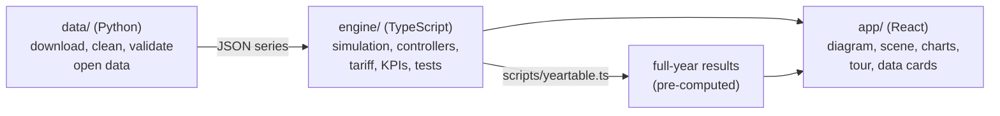

# Flexwerk

**A plant simulator for German commercial sites, running entirely in the browser.**

Build a site from parts (building load, rooftop solar, battery, electric van fleet, heat pump, grid connection), run it over real 2025–26 data in 15-minute steps, and watch the energy flow. Then compare control strategies, from simple rules to an optimiser that plans the battery, the vans and the heat pump **together**, and see what each one saves on a real German electricity bill.

**Headline result (logistics depot, full year, realistic forecasts):** the joint planner saves **€20,930 a year** after battery wear, about twice what simple price rules achieve (€10,283). It keeps 74 % of what a planner that knew the future would save. Every van leaves charged, the building gets all its heat, and no grid limit is broken.

---

## Contents

1. [What it does](#1-what-it-does)
2. [Structure](#2-structure)
3. [What it is based on](#3-what-it-is-based-on)
4. [The flexible assets](#4-the-flexible-assets)
5. [Controllers and forecasts](#5-controllers-and-forecasts)
6. [Results](#6-results)
7. [Tests and checks](#7-tests-and-checks)
8. [Limits](#8-limits)
9. [Run it yourself](#9-run-it-yourself)
10. [Data credits](#10-data-credits)

---

## 1. What it does

The app has two views:

- **Diagram:** each asset is a box, with lines showing how much power flows where at the current quarter-hour.
- **Scene:** an illustrated isometric picture of the site, which can be downloaded as an image.

Below them, charts show every asset over time, with a playhead you can drag.

Each run answers three questions:

- **Does the site stay safe?** Grid import, the connection fuse and the export limit are respected every quarter-hour.
- **What does it cost?** The full German commercial bill: energy price, grid fees with the annual peak charge, levies and taxes.
- **What does the control strategy add?** Every result is compared with the same site running with no control.

## 2. Structure



| Folder | What is in it |
|---|---|
| `data/` | Python scripts that fetch the open data, turn it into one shared time axis (1 Oct 2025 – 30 Sep 2026, 15 min, 35,040 steps), and check each series against an independent reference. The output goes to `app/public/data/`. |
| `engine/src/assets/` | One file per asset type: `load`, `pv`, `battery`, `grid`, `ev`, `heatpump`. Each declares its settings (default, unit, range, help text, source) and its behaviour. New asset types plug into `registry.ts`. |
| `engine/src/sim/` | The step loop and the **safety layer** (see below). |
| `engine/src/control/` | Controllers: idle, static peak shaving, price rules, MPC (the optimiser, with its linear program in `lp.ts`). |
| `engine/src/forecast/` | What a controller is allowed to know about the future. |
| `engine/src/tariff/` | The German commercial bill (Netz Leipzig 2026). |
| `engine/src/kpi/` | Savings, peak, battery cycles, pass/fail checks. |
| `engine/tests/` | 42 automatic tests (section 7). |
| `app/` | The browser app. The simulation runs in a Web Worker, so the page never freezes. |

**How one quarter-hour is simulated**

1. Each fixed asset (load, solar) reports its power from the data.
2. Each flexible asset reports what it **must** take now and what it **could** take. For example, a van leaving soon must charge now.
3. The controller asks for a power for each battery and flexible asset. A controller can only *ask*.
4. Physics clips each request to what the asset can do.
5. The **safety layer** enforces the site's limits in a fixed order:
   1. the battery may not export;
   2. the import limit;
   3. the connection fuse;
   4. the export limit.
   It cuts battery charging first, then slows flexible loads, but never below what they must take. Anything still over a limit is recorded, never hidden.
6. The energy balance is checked: the grid's power must equal the sum of all assets' powers.

Sign convention: positive power is drawn from the site's connection point.

## 3. What it is based on

Every number is either from a cited source or labelled **"example choice"** in the app. Every data series is checked against an independent reference. The full list with links and check results is in [SOURCES.md](SOURCES.md), and every design choice is explained in [DECISIONS.md](DECISIONS.md).

| Input | Source | How it was checked |
|---|---|---|
| Electricity price (day-ahead, Germany, 15 min) | Bundesnetzagentur / SMARD via Energy-Charts | Monthly means vs SMARD: 12 of 12 within 0.01 % |
| Building load (warehouse, factory, cold storage) | Measured commercial sites, Open Power System Data (CoSSMic, Konstanz) | Spike and plausibility checks. Scaled to the annual consumption you choose |
| Solar | DWD 10-minute weather station Leipzig/Halle, put through standard published PV models | Yearly yield vs EU PVGIS: +3 to +5 % in the same years |
| Van charging | 35,152 real sessions of 156 British Gas vans (Optimise Prime) | Energy per van per year −0.3 % vs source; daily shape vs Royal Mail depots |
| Heat demand | Outdoor temperature at Leipzig, standard German degree-day rule (VDI 3807) | Share of heat in winter (informational) |
| Heat-pump efficiency | When2Heat efficiency curve (Ruhnau et al. 2019) | Yearly efficiency vs Fraunhofer ISE field test (mean 3.4): floor heating −1 %, radiators −15 % (flagged) |
| Grid fees, levies, taxes | Netz Leipzig price sheet 2026, German statutes | Hand-checked bills in the tests |
| Battery | FoxESS C&I LFP cabinet datasheet; investment cost range from Fraunhofer ISE (2024) | Values cross-checked against the documents |

**The rule that shapes the results: the 2,500-hour switch.**
- **How it works:** German grid fees come in two price pairs. A site whose consumption is steady (more than 2,500 "full-load hours" a year) pays a high price per kW of yearly peak (about €102/kW) and a low price per kWh. A peaky site pays the reverse (about €12/kW).
- **What it means:** cutting the peak is worth roughly eight times more on a steady site.
- **How the simulator handles it:**
  - it bills the exact rule;
  - the optimiser plans with the price pair the site is expected to fall in;
  - every result shows which side of the switch the site landed on.

## 4. The flexible assets

### Battery
- **Model:** energy store with a charge and a discharge efficiency (89 % round trip), state-of-charge limits, and a power rating.
- **Default size:** 430 kWh / 200 kW, the size of two of the cited datasheet's cabinets.
- **Wear:** priced at a placeholder €78 per MWh discharged (€625/kWh investment ÷ 8,000 cycles). All results are shown *after* this wear cost.
- **Not allowed:** exporting to the grid. It serves the site behind the meter only.

### Electric van fleet
- **Data:** each van follows the measured sessions of one real van over a year (arrival, departure, energy needed). You can pick from 1 to 156 vans, at 7.4 kW per charger by default.
- **Must-charge rule:** if a van could no longer get its energy in the time left, the missing part must be charged now. This is the asset's minimum.
- **Sharing the power:** every van first gets its must-charge power, and any spare power goes to the van that leaves first.
- **Its own rules,** used when the optimiser is not in charge:
  - charge at once (also the baseline);
  - spread evenly over the stay;
  - cheapest quarter-hours before departure.
- **What the optimiser sees:** the fleet as one "energy envelope": how much power is available, and how much energy must and could be delivered by each future step.
- **Reported:** energy still missing when a van leaves (it must be zero).

### Heat pump with hot-water tank
- **Heat demand:** you set the space heating and hot water per year (default 300 + 20 MWh). Space heat is spread over the year by how cold Leipzig is: a day needs heat when its mean is below 15 °C, in proportion to 20 °C minus that mean, and colder hours get more. Hot water is flat.
- **Efficiency (COP):** depends on the outdoor temperature and on the heating system. Radiators need hotter water than floor heating, so they are less efficient.
- **Tank:** default 200 kWh of heat. It lets the heat pump run earlier, when power is cheap or the site's peak is low, and deliver the heat later.
- **Its own rules:**
  - on demand (also the baseline);
  - pre-heat in the 6 cheapest hours of each day.
- **What the optimiser sees:** forecast heat demand and efficiency, the tank level, and the tank size.
- **Reported:** heat the building did not get (it must be zero).

**What makes Flexwerk different:** the optimiser plans all three assets at once, so it can choose to charge the vans later, pre-heat the tank, *or* discharge the battery, whichever is cheapest at that moment.

## 5. Controllers and forecasts

| Controller | What it does |
|---|---|
| Idle (baseline) | Battery does nothing; vans charge at once; heat pump runs on demand. Every result is compared with this. |
| Static peak shaving | Discharge whenever import would exceed a fixed threshold; recharge below it. |
| Price rules | Peak protection, then charge from solar surplus, discharge in the dearest hours, charge in the cheapest. |
| **MPC (optimiser)** | Every hour, solves a linear program for the next 24 hours (12 and 36 also available): lowest energy cost + peak charge + battery wear, subject to every asset's limits. Plans battery, vans and heat pump together, then follows the first step. Solver: HiGHS, compiled to WebAssembly. |

**Forecasts.** Every run can be done twice:
- **Perfect:** the controller knows the real future. This is the upper bound.
- **Realistic:**
  - tomorrow's prices only after they are published at 13:00 (before that, today's prices are repeated);
  - building load = same time last week;
  - solar and heat = same time yesterday;
  - van arrivals = last week's (vans already plugged in are known).

The gap between the two shows how much value is lost to forecasting.

## 6. Results

Full year, Oct 2025 – Sep 2026. Net saving per year compared with the uncontrolled site, **after battery wear**. Realistic forecasts; perfect-forecast MPC in brackets.

| Site | Peak shaving | Price rules | MPC, realistic (perfect) |
|---|---|---|---|
| Logistics depot (warehouse, 400 kWp solar, 40 vans, heat pump) | €1,651 | €10,283 | **€20,930** (€28,178) |
| Small factory with solar | €9,823 | €5,388 | **€9,145** (€20,834) |
| Logistics warehouse | €137 | €8,104 | **€12,943** (€17,815) |
| Cold storage | €5,457 | €5,793 | **€11,795** (€17,028) |

All four sites have a 430 kWh / 200 kW battery, except cold storage at 645 kWh / 300 kW.

What the table shows:

- **The optimiser wins when it has room to adapt.** At the depot it keeps 74 % of its perfect-forecast value, because a wrong guess about one asset can be absorbed by the others.
- **A simple rule can beat the optimiser.** At the factory, the only flexible asset is the battery. One badly forecast day sets the whole year's peak charge, so the realistic optimiser (€9,145) ends up below simple peak shaving (€9,823).
- **Nothing is sacrificed.** Across all sites and strategies: zero limit breaches, zero energy missing for vans, zero heat missing.

These numbers are recomputed by `engine/scripts/yeartable.ts` and shown in the app.

## 7. Tests and checks

**Automatic tests (42, `npm test`).** Each runs the simulator on a case with a known answer:

| Group | Tests | What they prove |
|---|---|---|
| Energy balance | 5 | For all four example sites, every quarter-hour of the year, power in = power out; battery energy adds up. |
| Safety layer | 8 | Limits apply in the fixed order; battery charging is cut first, flexible loads only down to their minimum; overloads are recorded, not hidden. |
| Battery | 3 | State of charge and power always stay within limits. |
| Bill | 4 | Hand-calculated bills match, including the 2,500-hour switch and no export payment at negative prices. |
| Optimiser and forecasts | 13 | The linear program matches cases solved by hand; forecasts only use information available at that moment; summer-time change is correct; the optimiser beats peak shaving with perfect forecasts. |
| Vans and heat pump | 9 | Every van leaves charged under every rule; the building gets all its heat for a full year; the tank stays within its size; on the depot the optimiser lowers cost and peak with nothing missing. |

**Data checks (`python data/validate_all.py`).** Every data series is compared with an independent reference: 27 pass, 1 flag (radiator heat-pump efficiency, 15 % below the field-test mean but inside its measured range), 0 fail, 5 informational. The results feed the **Data** panel in the app.

## 8. Limits

The full list, with how each limit could move the results, is in [LIMITS.md](LIMITS.md). The main ones:

- **Load data:** the building loads are measured shapes from smaller sites, scaled up, and from different years than the prices. Public holidays are not matched. The cold-storage profile is a proxy.
- **Weather:** one weather station and one year. The solar model reads 3–5 % above PVGIS.
- **Tariff:** one grid operator (Netz Leipzig) and the 2026 rules only. A planned reform (AgNes, from 2029) would change how the peak is charged.
- **Battery:** it may not export. Its wear is a simple placeholder cost, not yet a degradation model.
- **Heat pump:** simplified. Heat demand comes from temperature only (no opening hours or weekends), and there are no tank losses or defrost cycles.
- **Van data:** the sessions are from UK vans that charge at drivers' homes, used here as depot visits.
- **Forecasts:** the realistic forecasts are simple "same as yesterday / last week" guesses. Better forecasts would raise the realistic results.
- **Speed:** the optimiser plans in 15-minute steps for the first 4 hours, then hourly. A full year takes about a minute per run, so the full-year table is pre-computed.

## 9. Run it yourself

Needs Node 20+ (and Python 3.11+ only to rebuild the data).

```bash
npm install
npm test          # the 42 engine tests
npm run dev       # the app at http://localhost:5173
npm run build     # static site in app/dist
```

To rebuild the data from the original sources, see [data/README.md](data/README.md).

## 10. Data credits

This project uses open data. Thanks to the providers:

- **Electricity prices:** Bundesnetzagentur | SMARD.de, via the Energy-Charts API (Fraunhofer ISE). [CC BY 4.0](https://creativecommons.org/licenses/by/4.0/).
- **Weather (radiation, temperature):** Deutscher Wetterdienst (DWD), Climate Data Center. [CC BY 4.0](https://creativecommons.org/licenses/by/4.0/).
- **Building loads:** Open Power System Data, household_data 2020-04-15 (CoSSMic project). [CC BY 4.0](https://creativecommons.org/licenses/by/4.0/).
- **Van charging sessions:** Optimise Prime (UK Power Networks and partners), UK Power Networks Open Data Portal. [CC BY 4.0](https://creativecommons.org/licenses/by/4.0/).
- **Solar reference values:** PVGIS © European Communities, 2001–2026.
- **Heat-pump efficiency curve:** When2Heat, Ruhnau, Hirth & Praktiknjo (2019), *Scientific Data* 6:189 (code MIT).
- **Grid fees:** Netz Leipzig GmbH, Preisblatt Netznutzungsentgelte Strom 2026.
- **Solver:** HiGHS (MIT), via the `highs` npm package (MIT).

Data were cleaned, resampled to 15 minutes and scaled. These changes are described in [SOURCES.md](SOURCES.md) and [DECISIONS.md](DECISIONS.md).

Code licence: MIT.
